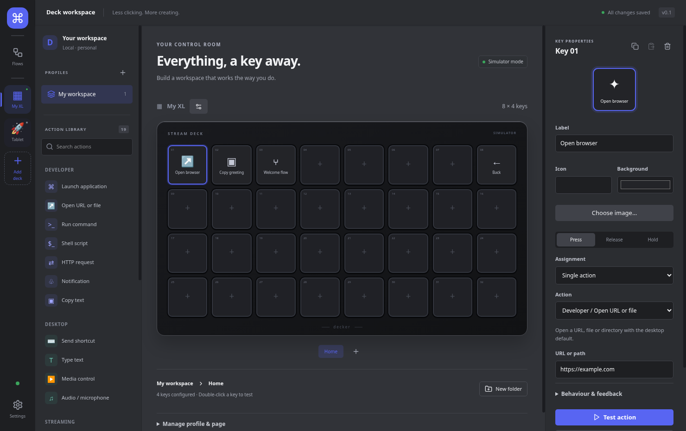

# Decker

A local Linux Stream Deck app with a Discord-inspired workspace, a configurable accent colour, and a visual workflow editor. Configure independent hardware, simulator and web decks. A phone or tablet can operate a web deck through its browser on the same local network.



## Run locally

Requires Linux x64, Node.js 24+, npm, and the GTK/NSS libraries required by Electron.

```sh
npm ci
npm run dev
```

The install step downloads the Electron binary before checking native modules.
`npm run dev` also ensures the binary is installed, repairing existing installs
that otherwise fail with `Error: Electron uninstall`. The first download needs
network access; subsequent runs reuse the installed binary.

The default workspace includes an XL simulator. Use **＋ Add deck** below your decks to scan for Stream Deck hardware or create a web deck/simulator. Every deck has a name, icon and its own profiles/pages. Select a key and choose or drag an action from the library. Double-click a key or use **Test action** to execute it. **Hold simulated key** exercises press, release and long-press bindings. Actions really execute on the local desktop, including in simulator mode.

- **Deck:** profiles, pages, nested folders, labels, images, multi-actions, trigger bindings and concurrency policies.
- **Flows:** connect control ports; configure data with literal values or field references; edit parallel branches and loop bodies on their own canvases. Explicit groups join before the next connection.
- **Settings → Diagnostics → Run history:** status, revisions, per-node timing, errors and bounded/redacted data, with deck/workflow filters.
- **Settings:** accent colour, simulator, brightness, desktop diagnostics, OBS connections, credentials, autostart and workspace import/export.

Closing the editor hides it by default. Runs and physical keys continue working. Choose **Quit Decker** in the tray to stop the application. A Linux tray/status-notifier extension may be necessary for your desktop. Disable close-to-tray if your desktop does not display tray icons.

## Web decks on your local network

1. Choose **＋ Add deck → Web deck**, set a name/icon and rows/columns (1–16 each), then create it. Creation enables local sharing, normally on TCP port 9018. You can pause it or choose another port under **Settings → Web decks**.
2. Configure its keys in the desktop editor. **Deck settings** changes the icon, accepts an uploaded image, copies profiles from another deck, and resizes the grid. Keys keep their row/column coordinates; assignments outside a smaller grid stay saved and return when expanded.
3. Choose **Connect browser**. The QR code defaults to a local-network address; choose the address for the network your phone/tablet uses. **This computer** is a loopback address for local testing, not a phone address. The QR/link expires after two minutes and is single-use.
4. Open it in a browser, give the browser a name, and request pairing. Match the displayed code and approve on the desktop, either in the connect dialog or under **Settings → Web decks**. No phone/tablet app installation is required.
5. Tap or hold configured keys. Actions execute on the Decker computer. Live key feedback, profiles/pages and folders belong to that deck. Multiple browsers viewing one deck share its current page; separate decks operate independently. Use **Revoke access** to disconnect a paired browser immediately.

Decker must remain running; the editor may be closed to the tray. The computer and browser must be on the same network, and any host firewall must allow the chosen local port. The service listens on IPv4 interfaces, accepts private/loopback/link-local peers, validates host/origin, and has no public/cloud relay. **LAN transport currently uses HTTP/WebSocket without TLS, so use a trusted local network.** Pairing authorizes host actions; it does not encrypt traffic.

The browser is an operator interface. It receives display state, sends validated key events and receives only assets used by its deck; it cannot edit configurations or submit commands. Pairing credentials are HttpOnly/SameSite cookies with separately hashed server records in `web-clients.json`, outside workspace exports. Browser pairings survive restarts on the same host address; imports reset pairings and pause sharing. Different hostnames/IP addresses use separate browser cookies. Disconnect/background clears held keys, disables controls and reconnects without replaying input.

Configuration schema v2 migrates v1 workspaces automatically after creating a migration backup, preserving assignments and history. Existing XL key indices are converted to fixed row/column coordinates. Old hardware entries get independent profile copies. Hardware discovery does not add duplicate configured decks or write to unconfigured devices.

`npm run dev` builds the browser controller before starting Electron development. Rebuild to refresh the browser controller after editing its files.

## Linux integrations

- Keyboard shortcuts and literal typing use `xdotool` on **X11**. General Wayland input injection is deliberately reported as unavailable.
- Audio probes the running `wpctl` service, falling back to `pactl`. Use `@DEFAULT_AUDIO_SINK@` for output and `@DEFAULT_AUDIO_SOURCE@` for microphone, or a backend device ID. Mute values: `0`, `1`, `toggle`; volume: `0`–`1.5`; default-device selection requires a concrete ID. The backend must support the selected target.
- Media uses MPRIS through the session D-Bus. Leave the player name blank to select the first available player, or specify its bus name. No `playerctl` dependency.
- OBS requires OBS Studio's WebSocket server. Add its URL in Settings, save its password under a credential reference, and use the connection ID in OBS actions. Observed status comes from OBS events.
- Commands accept an executable and a **JSON argument array**. Shell scripts are a separate, explicit action. Command process groups receive TERM followed by KILL on cancellation.
- HTTP supports HTTP(S), bounded response bodies and optional bearer credentials by reference. Requests carrying credentials do not follow redirects.

Install the relevant optional tools through your distribution, for example `xdotool`, `wireplumber`, and `pulseaudio-utils`. No desktop services or USB permissions are modified automatically.

### Stream Deck USB permissions

The maintained community package `@elgato-stream-deck/node` owns protocol framing and model-specific encoding. For an XL (`0fd9:006c`), use a desktop-user udev rule:

```udev
SUBSYSTEM=="hidraw", ATTRS{idVendor}=="0fd9", ATTRS{idProduct}=="006c", TAG+="uaccess"
```

An administrator can install it as `/etc/udev/rules.d/70-decker.rules`, reload with `sudo udevadm control --reload-rules`, then unplug/reconnect the deck. Check the actual logged-in user's device access. Existing distribution rules may already provide access. Never run Decker as root, and close other applications controlling the same deck. Serial numbers are used when available; transient hidraw paths are never persisted as identity.

Other models use discovered geometry but are **not hardware-verified**. The adapter polls for hotplug, clears held keys on disconnect/suspend, restores the current page and brightness after reconnect, serializes writes and coalesces pending key updates. No missed press is replayed.

## Desktop URL and file actions

Use **Open URL** for HTTP(S) addresses without embedded credentials and **Open file** for host paths. The file selector chooses an existing file and stores its absolute path; manual entry and workflow data references remain available. Relative paths resolve from Decker's application working directory, which can depend on how it was launched. Paths preserve spaces and Unicode, URLs cannot be opened as files, and desktop opening failures appear in run history. Saved **Open URL or file** assignments remain editable and executable without changing their action ID or schema version.

For action authors, `Field.type: "file"` with `picker: "openFile"` adds a native selector beside the normal literal or `$ref` editor. The strict desktop request `{ type: "pickFile", picker: "openFile" }` returns an absolute path string or `null` on cancel; it accepts no caller-supplied filesystem options. `FilePickerButton` invalidates pending results when its document location, field, action configuration or editor navigation changes. The image asset picker remains separate. Paired browsers have only their existing key input protocol and cannot request this dialog.

`ActionDefinition.paletteVisible` defaults to visible. Setting it to `false` excludes an action from `paletteCatalog` and new assignment choices while retaining its definition in `catalog` / `actionById`, import validation and execution. Existing assignments include their hidden action in the editor selector. Future actions can reuse these field and visibility contracts without changing document schema v3.

## Workflow contract

Actions on keys and graph nodes share the same versioned definitions and configuration schemas. The runtime uses XState promise actors for run lifecycles, a validated structured graph for control flow, and AbortSignals for cancellation. No arbitrary JavaScript is evaluated in field bindings.

```json
{"$ref":"outputs.node-id.body","fallback":"not available","transform":"uppercase"}
```

References can read `inputs`, `outputs`, `vars`, `item`, `index`, and routed `error`. Transformations: `string`, `number`, `lowercase`, `uppercase`, `length`. An output reference must be available on every path, or have an explicit fallback. Referencing data never executes a node again.

Condition operators are `equals`, `notEquals`, `greater`, `less`, `contains`, and `truthy`. Connect the `true`/`false` ports, or a switch's named/default ports. An unconnected selected port ends that branch. Connect an `error` port to recover from a failed node. Otherwise failures end the run.

Parallel defaults to fail-fast with cooperative sibling cancellation; `mode: "collect"` returns a result per branch. Repeat and For Each require `maxIterations` (1–1000). For Each supports bounded concurrency (1–16, default 1); each branch/iteration has isolated variables and ordered outputs. Each run has a timeout and a 10,000-node budget. Retries are bounded; non-idempotent actions require explicit opt-in. Subflow references pin revisions, reject recursive cycles, and snapshot all definitions at run start. Parent cancellation propagates.

Repeated key presses default to **ignore while running**. Queue, restart-after-cancellation and bounded concurrent policies are available in key properties. Keyboard/audio/OBS/conflicting command resources are serialized across flows. Press/release/hold trigger activity is coordinated separately so release handling can proceed during a press action. Cancellation cannot reverse external side effects already completed; app launches intentionally outlive their launching action.

## Storage and security

The desktop renderer is sandboxed with context isolation, no Node integration, a restricted preload API, sender checks, validated requests and a Content Security Policy. HID, execution and the local web service run in supervised Electron utility processes. This is crash isolation, not a sandbox for user-authored commands.

Configuration and history are stored under Electron's Linux user-data directory (normally `~/.config/decker`). Saves are serialized and atomically replaced. Unsupported schema versions and unreadable configurations are backed up. Images are stored separately by SHA-256. Imports validate the document, graphs and image checksums; review imported commands before activation. Imports back up the current workspace.

Credentials stay outside configuration, exported workspaces and the renderer. OS-backed `safeStorage` is used only when the selected backend is secure. `basic_text` or an unavailable keyring requires session-only credentials. Run traces redact sensitive field names and known credential values, truncate output, and bound retained history. Active runs are marked interrupted after a crash/restart; side effects never resume automatically.

## Verification and packaging

```sh
npm run check
xvfb-run --auto-servernum npm run test:e2e
npm run package
DECKER_EXECUTABLE=release/linux-unpacked/decker xvfb-run --auto-servernum npm run test:e2e
```

Produces `.deb` and AppImage under `release/`. Both packaging scripts explicitly disable publishing, so CI builds artifacts without requiring `GH_TOKEN` or creating GitHub releases. The lockfile pins stable dependency resolutions. `node-hid` and `sharp` ship ABI-stable Node-API prebuilds, so no Electron header rebuild is needed. Native binaries are unpacked from ASAR; CI loads them from the packaged Electron workers and runs the same UI/runtime smoke tests against the package.

Pull-request and branch CI runs static checks/unit tests, source Electron tests, and Linux packaging/packaged Electron tests in parallel jobs. Source and packaged test reports are uploaded separately. The `Test and package Linux` check requires all three jobs to pass before the same-run installer artifact can be published on a develop push.

See [acceptance coverage and manual checks](docs/ACCEPTANCE.md) for verification boundaries. Physical HID operation, unplug/replug, suspend/resume, Pop!_OS and Wayland session behaviour require host testing; simulator and CI results do not establish those hardware gates. Latency targets in REQUIREMENTS.md remain measurement targets.

The repository is private and does not currently grant an open-source license. Distribution/license intent remains a project-owner decision.
