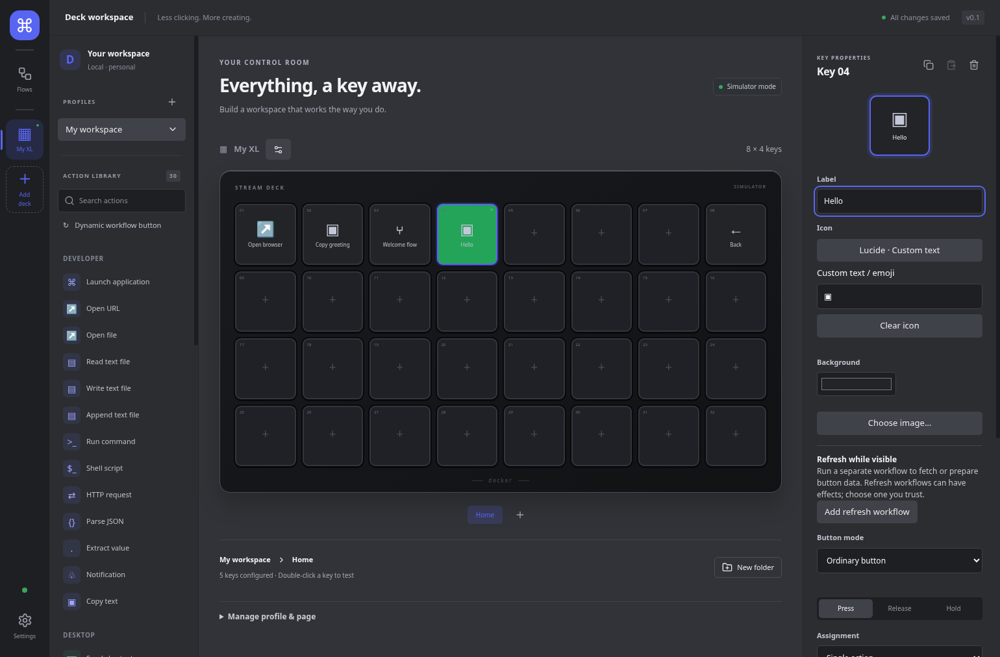

# Decker

Decker turns Stream Deck keys, a desktop simulator, or a paired phone browser into
buttons for local Linux actions and workflows. Linux x64 is the build target;
physical hardware and Pop!_OS acceptance are still pending.



## Download and start

1. Open [Releases](https://github.com/ianwijma/decker/releases) and choose a tested
   **development prerelease**. Nightly/develop builds exist; no published stable
   release was available when checked on 17 October 2026. Match its manifest and
   checksums to the installers; see [download verification and Linux prerequisites](docs/install.md).
2. Install the Linux **amd64 `.deb`** and open **Decker** from the application menu
   (terminal: `decker`), or make the **x86_64 `.AppImage`** executable and launch it.
   The [installation guide](docs/install.md) gives exact commands for one selected file.
3. On **Home**, review current health. Select **My XL**, the included simulator,
   or use **Add deck** to add discovered hardware, a simulator or a web deck.
4. Select an empty key, choose **Copy text** from the library, set **Label** to
   `Hello` and **Text** to `Hello from Decker`. Click **Test action**, then paste
   into a text editor. Double-click the simulator key to try its saved button.

Simulator actions execute on your computer too. Closing the editor normally keeps
Decker running in the tray; **Quit Decker** stops it. If your desktop lacks a tray,
disable **Settings → General → Close editor to tray** before closing the window.

## Next steps

- [Current user guide](docs/USER-GUIDE.md): Home, profiles, flows, icons, toggles,
  OBS, schedules and refresh, with exact navigation.
- [Web deck setup](docs/web-decks.md): desktop-approved pairing on a trusted LAN.
- [Working local data example](docs/data-example.md) and
  [live avatar refresh](docs/visible-button-refresh.md#working-local-avatar-example).
- [All guides and technical contracts](docs/README.md),
  [Linux troubleshooting](docs/linux-setup.md), and [storage/security](docs/security.md).

## Run from source

Requires Linux x64, Node.js **24+**, npm (CI uses Node 24), Git and the
[Electron runtime prerequisites](docs/install.md#runtime-prerequisites).

```sh
git clone --branch develop https://github.com/ianwijma/decker.git
cd decker
npm ci
npm run dev
```

Installation downloads Electron and checks native modules; the first run needs
network access. `npm run dev` ensures Electron is installed and builds the browser
controller before starting development. See [development and packaging](docs/development.md)
for verification commands and isolated test workspaces.

The GitHub repository is public. No open-source license is currently granted;
there is no top-level LICENSE. `private: true` in package.json prevents npm
publication and does not describe GitHub visibility. Distribution/license intent
remains a project-owner decision. [Third-party icon notices](src/shared/icon-notices.txt)
retain their own terms.
