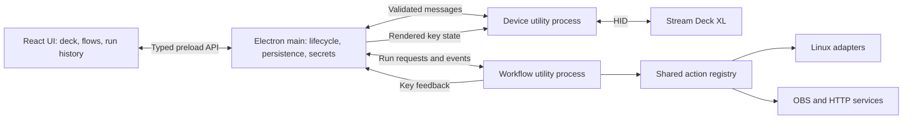
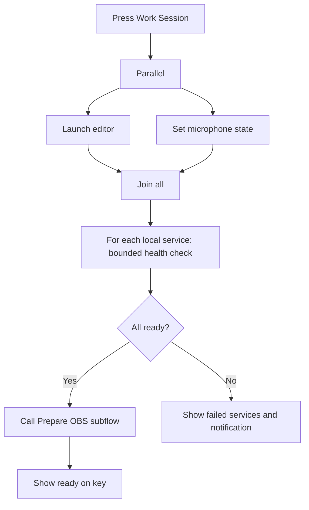

# Decker — Linux Stream Deck application plan

Planning date: 14 October 2026 (Australia/Sydney).
Status: software implementation delivered; see [acceptance coverage](docs/ACCEPTANCE.md) for automated evidence and the hardware/desktop gates still requiring host access. The proposal below is retained as the original scope and architecture reference.

## Product and confirmed scope

Build an Electron desktop application that configures and operates Stream Deck hardware on Linux. Use TypeScript and Tailwind, prefer maintained npm packages, and provide both ready-made actions and a visual workflow editor inspired by n8n.

The user confirmed that the target includes all three action groups: developer workflows, streaming/audio/media, and desktop automation. Workflows must cover sequences, conditions, variables, delays, loops, parallel branches, and reusable subflows. The milestones below sequence that work; advanced flows are part of the intended first complete release.

Recommended product model: **every action can be assigned to a key or used as a workflow node**. A key can run one configured action, a simple ordered multi-action, or a named workflow. These share execution, validation, status, and logging. Users should not need to open a graph to configure a URL or mute button.

Elgato's app supplies the interaction reference: deck preview, action catalog, properties inspector, profiles, folders, pages, appearance, and multi-actions. The differentiator is integrated Linux automation and programmable flows. [Product reference](https://www.elgato.com/ww/en/s/stream-deck-app).

## Local findings and what remains unverified

Read-only inspection found:

- Pop!_OS 22.04 LTS; session environment reports X11 and Pop/GNOME.
- Connected **Elgato Stream Deck XL**, USB vendor/product `0fd9:006c`, identified through sysfs. Its HID entry is `hidraw5`; the number is transient and must never be stored as device identity.
- An existing `/etc/udev/rules.d/50-elgato-stream-deck-headless.rules` includes this model with `plugdev` access. Rule presence does not establish effective access in the logged-in session.
- `xdotool`, `pactl`, and `wpctl` are installed; `playerctl` was not found on PATH.
- The repository has no commits or implementation and originally contained an empty, untracked `REQUIREMENTS.md`.

The tool sandbox does not expose `/dev/hidraw5` or the USB bus device nodes; `lsusb` failed to initialize libusb. This investigation therefore confirms device identification only, not successful HID opening, key events, image writes, or hotplug behavior. No device state or system permissions were changed.

## Recommended architecture

Use one desktop project with clear internal modules before introducing a monorepo or plugin SDK.



- **Renderer:** deck configuration, flow canvas, node inspector, run inspector. No direct Node.js, filesystem, shell, or HID access.
- **Main:** single-instance lifecycle, tray, configuration ownership, secret access, IPC routing, utility-process supervision. Closing the editor hides it; explicit Quit stops the runtime.
- **Device process:** owns HID connections, translates key events, renders and sends key images, reconnects, and reports device health. A slow command or failed workflow must not block button input.
- **Workflow process:** runs immutable workflow revisions, dispatches action handlers, manages concurrency and cancellation, and emits structured execution events independently of mounted UI components.
- **Adapters:** explicit interfaces for keyboard input, app launch, audio, media, OBS, and device feedback. Report capabilities and actionable errors rather than assuming every Linux desktop behaves identically.

Electron's `utilityProcess` provides a Node-enabled child-process mechanism. Process separation helps responsiveness and crash containment; it is not a security sandbox for arbitrary user code. Keep the renderer sandboxed, use context isolation, and expose narrow validated methods through preload. [Utility processes](https://www.electronjs.org/docs/latest/api/utility-process), [Electron security guidance](https://www.electronjs.org/docs/latest/tutorial/security).

## Package choices

These are proposed dependencies, not a tested lockfile. Select compatible stable releases during the first spike and verify them in a packaged Electron build. Some upstream documentation currently defaults to prerelease tracks, so documentation URLs alone must not determine versions.

| Concern | Proposed package/API | Reason and qualification |
| --- | --- | --- |
| Desktop and build | `electron`, `electron-vite`, TypeScript | Main/preload/renderer development with a shared build configuration. |
| Interface | React, `tailwindcss`, `@tailwindcss/vite` | Component-based editor with the requested styling stack. |
| Graph editor | `@xyflow/react` | Custom nodes, ports, connections, viewport, selection, and graph editing. |
| Execution foundation | `xstate` | Actor lifecycle, transitions, invoked asynchronous work, parallel state completion, and observable runtime state. |
| Validation | `zod` | Validate saved documents, action configuration, and process-boundary messages. |
| UI state | `zustand` | Local editor state; persisted configuration stays under main-process ownership. |
| Hardware | `@elgato-stream-deck/node` | Existing Stream Deck protocol implementation and TypeScript API. |
| Key imagery | `sharp` | Rasterize/resize/composite icons and text, cache resulting key images. Native dependency to verify in packaging. |
| Commands | `execa` | Subprocess output, exit status, timeouts, and cancellation support. |
| OBS | `obs-websocket-js` | Requests plus event subscriptions for accurate button feedback. |
| Linux desktop bus | `dbus-next` candidate | MPRIS media access and selected desktop services; validate compatibility/maintenance before locking. |
| Settings/profiles/flows | `electron-store` | Start with versioned JSON configuration, migrations, backups, and a single writer. |
| Credentials | Electron `safeStorage` | Use the available OS-backed secret protection; store credential references in flows. |
| Distribution | `electron-builder` | Initial `.deb` and AppImage targets. |
| Optional graph layout | `elkjs` | Automatic layout when manual placement becomes inconvenient. |

Use built-in `fetch`, `AbortController`, Electron shell/clipboard/notifications, and Node APIs where sufficient. Avoid adding HTTP clients, event buses, databases, and dependency-injection frameworks without a concrete need.

Package evidence: [electron-vite](https://electron-vite.org/guide/), [Tailwind/Vite](https://tailwindcss.com/docs/installation/using-vite), [React Flow](https://reactflow.dev/), [XState](https://github.com/statelyai/xstate), [Zod](https://zod.dev/), [Zustand](https://github.com/pmndrs/zustand), [sharp](https://sharp.pixelplumbing.com/), [Execa](https://github.com/sindresorhus/execa), [OBS client](https://github.com/obs-websocket-community-projects/obs-websocket-js), [D-Bus client](https://github.com/dbusjs/node-dbus-next), [electron-store](https://github.com/sindresorhus/electron-store), [electron-builder stable docs](https://www.electron.build/v26/), [ELK](https://github.com/kieler/elkjs).

### Hardware details

The proposed Stream Deck package is an independent community library for writing replacement software; it is not the official Elgato application or its plugin runtime. Its docs cover XL support, key down/up, key images, brightness, Linux udev setup, and an optional JPEG accelerator for XL performance. Benchmark static full-page refreshes before adding that optional native dependency. [Package README](https://raw.githubusercontent.com/Julusian/node-elgato-stream-deck/main/packages/node/README.md).

Let the library own HID protocol framing and model-specific image encoding. Cache composed assets and update only changed keys. Serialize writes per device and coalesce pending images so progress updates cannot create an unbounded queue. Identify hardware by stable device information where available; discover geometry and image dimensions from the adapter.

Reconnect must restore brightness and the current page. A device disconnect should clear held-button state and never replay missed presses. Require one controlling application per deck during testing to avoid conflicting display writes.

Native dependencies require early packaged testing against Electron's embedded Node runtime. A successful script under the host Node installation is insufficient. Validate rebuild/prebuild availability, native files outside ASAR where required, and target Linux compatibility. [Electron native-module guidance](https://www.electronjs.org/docs/latest/tutorial/using-native-node-modules).

## Workflow technology decision

| Option | What it reuses | Cost for this product | Recommendation |
| --- | --- | --- | --- |
| React Flow + XState | Graph interaction plus actor/statechart orchestration | We own the workflow schema, graph validation, graph-to-runtime adapter, data bindings, and action handlers. | Preferred provisional architecture for a custom integrated UI. |
| Rete editor + `rete-engine` | Node editing and explicit dataflow/control-flow primitives | Product-level run history, cancellation propagation, joins, retries, and persistence still need integration. | Strong fallback if the graph-to-XState spike requires excessive glue. |
| Embedded Node-RED | Existing flow runtime/editor and node ecosystem | Adopting its editor is the largest reuse win; replacing it with a custom React UI adds a substantial translation layer. | Choose if a full existing automation environment becomes more important than a unified deck UI. |
| Embedded n8n | Existing automation system and integrations | Larger embedded system and licensing constraints for exposing workflow authoring. | Use as UX inspiration; leave external webhook integration possible. |

React Flow is the editing layer; its computing examples do not provide all the required background execution semantics. XState provides runtime primitives, not automatic execution of arbitrary React Flow JSON. Our adapter is real work and is the main architecture risk. Prefer structured Branch, Parallel, Loop, and Subflow nodes so each graph has defined execution semantics.

Before committing, run the same small fixtures through an XState prototype: sequence, exclusive branch, parallel all-join, bounded loop, subflow, timeout, and cancellation. If this demands a general-purpose compiler or excessive statechart manipulation, evaluate Rete against those fixtures before building the production editor.

Evidence: [React Flow computing guide](https://reactflow.dev/learn/advanced-use/computing-flows), [XState parallel states](https://stately.ai/docs/parallel-states), [XState invoked actors](https://stately.ai/docs/invoke), [Rete engine](https://retejs.org/docs/concepts/engine/), [Node-RED embedding](https://nodered.org/docs/user-guide/runtime/embedding). Node-RED documents Apache-2.0 licensing; n8n describes restrictions around customer-facing workflow configuration. These affect dependency selection if the app is distributed. [Node-RED license](https://nodered.org/about/license/), [n8n licensing guidance](https://support.n8n.io/article/can-i-use-your-license-for-my-use-case).

## Interface and action catalog

Primary screens:

1. **Deck:** device/profile/page selectors, hardware-shaped key grid, searchable action catalog, and selected-key properties. Drag actions onto keys; support copy/paste, duplicate, clear, and a software test press.
2. **Flows:** searchable node palette, canvas, configuration inspector, validation, run/stop controls, and current execution highlighting.
3. **Runs:** success/failure/cancelled/interrupted status, node timings, bounded/redacted inputs and outputs, error details, and workflow revision.
4. **Settings:** device status, Linux capabilities, connections/credentials, brightness, startup/tray behavior, and import/export.

Profiles contain pages; folders navigate nested pages with a Back action. Keys have label/icon/background plus idle/running/success/error appearances. Dynamic state, such as microphone mute or active OBS scene, comes from the integration's observed state, not simply a counter of local button presses.

| Action group | First complete release |
| --- | --- |
| Developer | Launch executable/app, open URL/file/directory, run command or explicit shell script, HTTP request, notification, copy text. |
| Desktop | Send shortcut, type text, media play/pause/next/previous, volume/mute, microphone mute, select audio device where backend supports it. |
| Streaming | OBS scene selection, source visibility, input mute, recording/streaming controls, and connection/status feedback. |
| Deck | Change profile/page, enter/leave folder, brightness, change key appearance, run/cancel workflow. |
| Flow building blocks | Trigger, Action, Delay, Condition/Switch, Set/Map data, Parallel/Join, Repeat/For Each, Call Subflow, Return, error handling. |

Each action definition supplies an ID and version, configuration/input/output schemas, editor metadata, required capabilities, execution handler, and optional status subscription. The same definition populates the key inspector and node palette. Keep subscriptions separate from individual runs so multiple buttons can share an OBS connection or media-state feed.

## Execution contract

Decide these semantics before building the graph editor:

- **Triggers:** physical press, release, long press, and software test. Default to one press action. Long-press versus short-press behavior must be explicit; if both are bound, resolve short press on release when the long-press threshold was not reached. Capture the binding at press time so a profile change does not send release to a different action.
- **Flow data:** JSON-compatible named inputs and node outputs. Use a field picker, literal values, and bounded built-in transformations initially. No arbitrary JavaScript evaluation in ordinary field bindings.
- **Control:** explicit execution edges determine side-effect order. Referencing a node's data must not execute its side effect again. Validate that referenced output is available on the selected path; missing conditional output is a validation error or requires an explicit fallback.
- **Conditions:** exactly one selected output path. Default error behavior fails the run; explicit error routing can recover with structured error data.
- **Parallel:** explicit fork/join groups. Default join waits for all branches created by that fork, including well-defined empty/skipped results. Nested groups have distinct identities. No implicit "wait for all incoming canvas edges" rule.
- **Parallel failure:** default fail-fast, cancel cooperative sibling work, and wait for cleanup within a bound. An explicit collect-results mode can return success/error per branch. Side effects already completed cannot be automatically undone.
- **Loops:** structured Repeat and For Each with nested body, explicit maximum iterations, and a run timeout. For Each starts sequential; optional bounded concurrency is a declared setting. Prevent arbitrary back-edges and unbounded synchronous loops.
- **Subflows:** declared inputs/outputs and versioned references; parent cancellation and tracing propagate. Reject recursive call cycles initially. Snapshot all referenced revisions when a run starts.
- **Isolation:** each run and parallel branch gets separate data scope. Join outputs are keyed by branch; loop outputs by iteration. No concurrent mutation of shared run variables.
- **Repeated presses:** configurable ignore-while-running (default), bounded FIFO queue, restart-after-cancellation, or bounded concurrent runs. Display the chosen policy in the key properties.
- **Resource conflicts:** serialize keyboard typing and conflicting commands to the same external resource, even across different flows. A process-wide action coordinator can own these locks.
- **Timeout/cancellation:** run/node budgets and an AbortSignal propagated to HTTP, delays, subprocesses, and child flows. Cancellation stops future work and cooperatively stops current work; it cannot reverse completed external operations. Confirm process-tree cleanup rather than assuming killing a shell kills its children.
- **Retries:** explicitly configured and bounded; no automatic retry for non-idempotent commands, keypresses, or toggles. Prefer explicit state-setting operations when possible.
- **Persistence:** save definitions and bounded run history. Unexpected app/runner shutdown marks active runs interrupted; do not resume or replay side effects automatically in this release.
- **Editing while running:** affects the next run. Current executions retain their immutable definition snapshots. UI feedback carries run IDs and binding/page generations so old runs cannot overwrite newly assigned keys.

With XState, asynchronous action work belongs in invoked actors, not async statechart actions; XState does not await ordinary actions. Stopping an actor is only part of cancellation: each underlying operation needs an abort/cleanup implementation. [Invocation semantics](https://stately.ai/docs/invoke), [Execa termination behavior](https://github.com/sindresorhus/execa/blob/main/docs/termination.md).

Example target flow:



## Linux integration strategy

The main portability risk is desktop automation, rather than the Stream Deck protocol.

| Capability | Initial backend | Linux limitation/next step |
| --- | --- | --- |
| HID | Stream Deck npm library and existing udev mechanism | Diagnose effective device access; provide the upstream desktop-user udev rule in installation guidance. Never run the whole app as root. |
| Shortcuts and typing | `xdotool` through argument-array subprocess calls on X11 | It does not provide general Wayland support. Add a portal/compositor-specific backend only after testing target desktops. |
| Media | MPRIS over session D-Bus | Detect/select players and handle disappearance; validate the npm D-Bus client early. |
| Audio | `wpctl` where compatible, otherwise `pactl` | Runtime detection of the active audio service matters; executable presence alone is insufficient. Prefer structured output where available. |
| App launch | Executable plus arguments; desktop-entry launch through OS tooling | Do not implement desktop-entry shell parsing from scratch. |
| OBS/HTTP | Protocol clients | Mostly display-server independent; connections and credentials still need setup. |
| Automatic profiles | Later X11 active-window adapter, followed by desktop-specific adapters | Wayland active-window visibility is compositor-dependent. Manual profile switching is baseline. |

Electron global shortcut registration is not cross-application keyboard injection. The Wayland GlobalShortcuts portal also does not replace an input-injection backend. RemoteDesktop portal sessions can expose keyboard control, but permissions, backend support, and persistence must be evaluated separately. [xdotool limitations](https://github.com/jordansissel/xdotool), [RemoteDesktop portal](https://flatpak.github.io/xdg-desktop-portal/docs/doc-org.freedesktop.portal.RemoteDesktop.html).

Npm-first is practical for most of the application, but USB access, compositor permissions, and some system controls necessarily interact with Linux services/tools. Model these dependencies in a capability screen. Defer Flatpak packaging until host command execution, HID, D-Bus, and portals have a deliberate permission strategy.

## Data, credentials, and project shape

Core records: `DeviceConfig`, `Profile`, `Page`, `KeyBinding`, `ActionDefinition`, `ActionInstance`, `WorkflowDefinition`, `Connection`, `CredentialRef`, `RunRecord`, and `NodeExecutionRecord`.

Give documents a schema version and stable IDs. Keep semantic flow data separate from canvas position/viewport data. Nodes reference action type/version; bindings reference direct actions or workflow IDs. Store assets separately by content hash. Use app user-data storage, single-writer saves, migration backups, and validation on import. Limit retained run history by size/count; introduce SQLite only if history querying warrants it.

Credentials remain outside exported profiles and workflows. Electron safeStorage on Linux can fall back to `basic_text`, which does not provide meaningful secret protection. Detect insecure/unavailable storage and offer session-only credentials rather than silently persisting them. Redact headers/tokens and bound subprocess/HTTP output in logs. Imported commands are visible for review before activation. [safeStorage behavior](https://www.electronjs.org/docs/latest/api/safe-storage).

Suggested structure:

```text
src/
  main/           # lifecycle, persistence, credentials, IPC broker
  preload/        # narrow typed renderer API
  renderer/       # deck editor, flow editor, run inspector
  shared/         # schemas, action metadata, messages, IDs
  device/         # hardware worker, simulator, image renderer
  runtime/        # validation, runtime adapter, run coordinator, traces
  actions/        # shared action definitions and implementations
  adapters/linux/ # keyboard, audio, MPRIS, desktop launch
  integrations/   # OBS and other service clients
```

Official Elgato marketplace plugin compatibility is not assumed. A future Decker plugin API can expose the same action contract, but loading arbitrary npm plugins introduces lifecycle, dependency, and trust concerns beyond selecting npm dependencies at build time.

## Delivery milestones and acceptance criteria

| Milestone | Deliverable | Acceptance gate |
| --- | --- | --- |
| 0 — Hardware and runtime spikes | Minimal Electron shell; XL adapter; execution-library comparison fixtures | Open XL without root in the host session; read down/up; write a test key; restore app-owned page after reconnect. Packaged native modules load. Sequence, branch, parallel join, loop, subflow, failure, and cancellation fixtures establish the runtime decision. |
| 1 — Useful deck | 32-key XL preview, profiles/pages/folders, labels/icons, direct actions, persistence, tray lifecycle | Configure command, URL, shortcut, media/audio, and OBS examples. Buttons work with editor closed. Restart restores assignments; unavailable integrations show clear status. |
| 2 — Local flow editor | Shared action catalog, sequences, conditions, variables, delays, validation, run inspector | A hardware press runs a saved flow; outputs feed later nodes; errors identify the failing node. Runtime remains responsive while UI is hidden. |
| 3 — Advanced flows | Structured loops, parallel/join groups, subflows, concurrency policies, timeout/cancel/retry controls | Deterministic tests cover nested joins, skipped paths, isolated branch/iteration data, failed subflows, repeated presses, cancellation, and bounded loops. All requested flow capabilities are complete. |
| 4 — Linux release | Packaged `.deb`/AppImage, onboarding diagnostics, import/export, reconnection and migration handling | Test on the actual Pop!_OS/X11 machine and at least one selected Wayland desktop. Advertise only verified capabilities; include USB permissions and native-module packaging checks. |

Use focused runtime unit tests with fake action handlers and a simulated deck, renderer interaction tests for editing/validation, and packaged hardware/manual integration tests. Essential scenarios: unplug/replug, suspend/resume, OBS unavailable, audio target disappears, profile changes during a held key, editor closes mid-run, runner crashes, and app shutdown during a command.

Performance targets to measure, not claims of current behavior: idle input-to-run dispatch p95 below 50 ms on the connected machine; no blocked input during full-page redraw; bounded image/log/run queues; no missed releases in sustained interaction. Measure external command/OBS latency separately.

## Boundaries and remaining product decisions

Defaults proposed here: local single-user operation, offline configuration/execution except network actions, initial Linux x64/X11 validation, manual profiles, trusted built-in actions, no required cloud account, and no Redis/server dependency.

Outside the initial release: marketplace compatibility, arbitrary code/plugin installation, cloud synchronization, distributed/durable execution across restarts, animation/video backgrounds, and universal Wayland automation. Other deck models should fit the adapter but require their own hardware verification.

Still to decide during implementation: distribution/license intent, the first Wayland compositor to support, whether workflows need global variables beyond per-run inputs, and how much pause/step debugging is valuable. These do not block the hardware/runtime spikes.

Existing projects worth studying for behavior: [StreamController](https://github.com/StreamController/StreamController) demonstrates Linux deck UX, plugins, and desktop-specific profile switching; [Companion's module system](https://github.com/bitfocus/companion/blob/main/docs/user-guide/3_config/modules.md) demonstrates separate integration and hardware modules. Use them as design references; this plan does not assume their plugin APIs are interchangeable with Decker's.

**Recommended first implementation slice:** one XL button triggers an HTTP check, selects a success/failure branch, and changes its own key image, while the editor is closed. Pair that vertical slice with the advanced execution fixtures before investing in the full interface.

## Confirmed follow-up: independent decks and LAN web controllers

Confirmed 14 October 2026: left navigation becomes logo, Flows, one custom icon per deck, Add deck, and Settings. Run history belongs under Settings/Diagnostics. Adding a deck defaults to hardware discovery, with immediate web-deck creation as an alternative. Web decks have configurable rows/columns and are operated from phone/tablet browsers without an app installation. The first version is local-network-only and control-only in the browser; configuration remains in the desktop editor.

Decks own their profiles, active pages, icons and geometry; workflows remain shared. Browser actions execute on the Linux host, use the same runtime and observe live feedback. Pairing requires desktop approval and can be revoked. Resizing preserves assignments, migration backs up existing configuration, and editor navigation must not change another deck. See README and docs/ACCEPTANCE.md for implementation details and verification boundaries.
