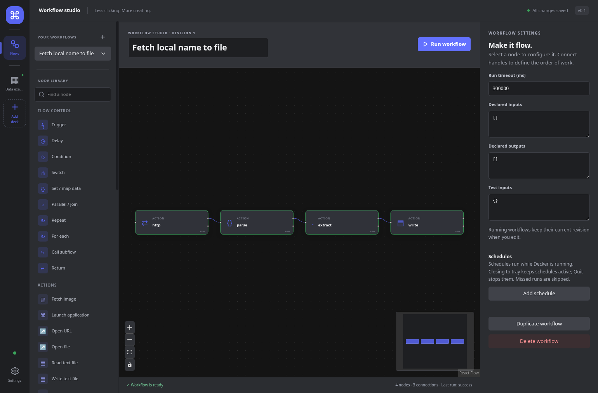

# Current user guide

## Home and decks

**Home** is the app/device/integration health overview. Presence means a device was
discovered, not that it is ready; ready driver status still does not certify
physical display/input. Add discovered hardware from Home or **Add deck**. A
configured disconnected deck keeps its assignments. Expand **Repair guidance**,
use **Copy repair text** or **Open documentation**, review/apply the guidance
outside Decker, then **Retry**. **Recheck** updates session checks. Decker does not
silently install tools or privileged udev rules. See [Diagnostics](diagnostics.md).

Select a deck in the left rail. Profiles use a searchable dropdown; pages and
folders belong to that deck. **Deck settings** changes the name/icon, grid for
simulator/web decks, and copies profiles. Resizing preserves assignments outside
the smaller grid. **Label**, **Background**, the bundled Lucide picker and image
uploads via **Choose image…** customize keys; see [desktop actions/artwork](desktop-actions.md).

## Flows and run history

Open **Flows** and use the searchable workflow selector. Edit the flow name at the
top. Add single-purpose action/control nodes and connect control ports; names in
workflow selectors hide UUID plumbing. **Run workflow** and **Cancel workflow**
actions select saved workflows by name. Control nodes retain the advanced JSON
configuration editor and existing switch port behavior; see the
[workflow contract](workflow-runtime.md) and [data binding guide](data-binding-ui.md).
Try the [local HTTP → Parse → Extract → Write example](data-example.md).

**Settings → Run history** is a separate section beside **General**, **Web decks**
and **Diagnostics**. It shows status, revisions, node timing and bounded/redacted
data with deck/workflow filters. Cancellation stops cooperative work but cannot
undo effects already completed. See the [runtime contract](workflow-runtime.md).

## Settings and integrations

**Settings → General** contains appearance, startup/history, import/export and
**Add OBS**. Enter OBS connection details and its password inline; **Test
connection** is read-only and tests the selected draft at that moment. It neither
saves the draft nor proves the runtime is currently connected. Follow
[OBS setup/testing](obs-setup-testing.md). Saved connections are chosen by name.
Persistent secrets need a secure OS backend; session-only secrets disappear on
restart and imported placeholders require re-entry. See [security](security.md).

Choose **Open URL** or **Open file** separately; Open file has a native host file
picker. Media actions are separate Play, Pause, Play/Pause, Next, Previous and
Stop choices. Increase/Decrease brightness and Read/Write/Append text are also
separate actions. Their [linked action guides](README.md) explain fields and
older saved-action compatibility. X11 typing uses xdotool; general Wayland input
injection is unavailable. MPRIS needs session D-Bus, not playerctl. Audio/OBS
availability and useful repair guidance come from [Linux setup](linux-setup.md).

## Toggle buttons

Select a key, choose **Button mode → Toggle on / off**, and configure independent
On and Off targets and artwork. Resolve any existing ordinary bindings explicitly,
then save before testing. App-managed state records successful transitions;
observed OBS/audio/media sources and custom probes reconcile external drift.
Unknown/stale/busy states are meaningful: failed or cancelled targets do not
blindly flip confirmation. A custom probe can execute a user command; review it
before **Execute saved toggle** or **Test / Refresh saved state**. For app-managed
uncertain state, verify it externally before acknowledging **I verified state is
on/off**. See [saved-state testing and recovery](toggle-runtime.md).

## Schedules and visible refresh

For standalone timers, open **Flows**, select a workflow and clear node selection
for **Schedules**. Create an interval or five-field cron definition, set the cron
IANA timezone, preview and save, then explicitly **Enable schedule**. New/copied/
imported definitions are disabled. Decker must remain running; closing to tray
keeps scheduling active, shutdown/sleep does not replay missed ticks. Intervals
start at 60 seconds. DST skips nonexistent local times and executes a repeated
local occurrence once. A schedule has no triggering button to update. See
[minimums, DST and lifecycle](workflow-schedules.md).

For a button that should update while shown, choose **Dynamic workflow button** or
**Refresh while visible → Add refresh workflow**. Choose the workflow and inputs,
**Save refresh**, then **Enable refresh**. The default is 60 seconds with an initial
visible attempt; **Every five minutes** is available. Eligible surfaces are ready
hardware displaying the current page, the visible selected simulator, or a
foreground paired browser that has rendered the current view. Multiple web
clients share one refresh for the same binding. Losing the last surface cancels
owned work. Refresh has generic backoff and retains last-good artwork on failure;
its last-success time is session-only. Press/toggle actions remain independent.
Use the [account-free local avatar example](visible-button-refresh.md#working-local-avatar-example)
in a test workspace; import replaces the current workspace. This is not a
Twitch/YouTube integration or OAuth/plugin compatibility feature.
